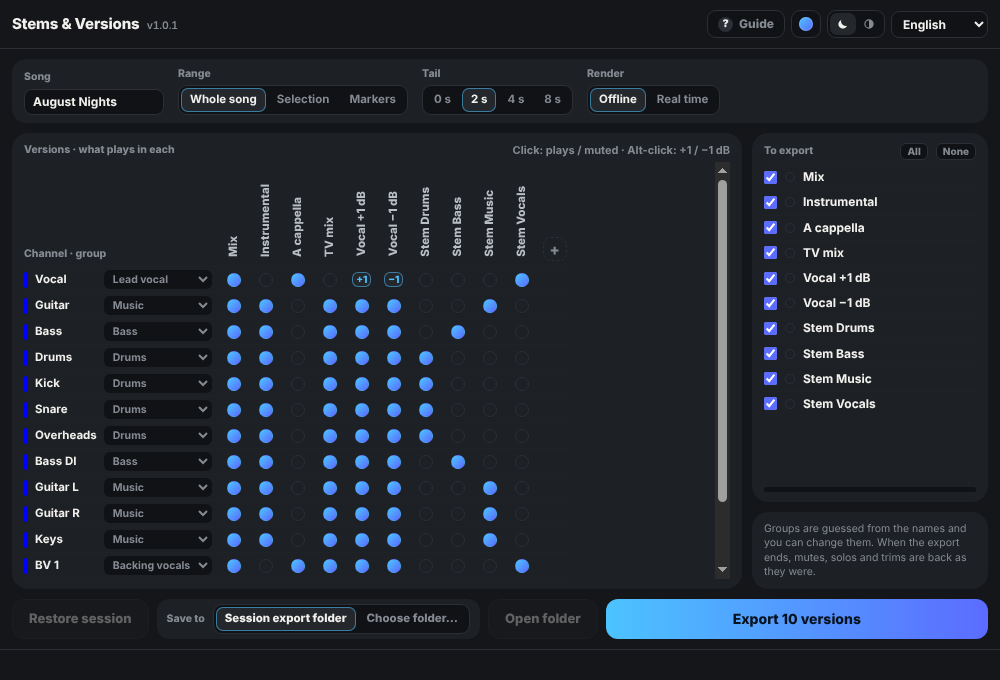
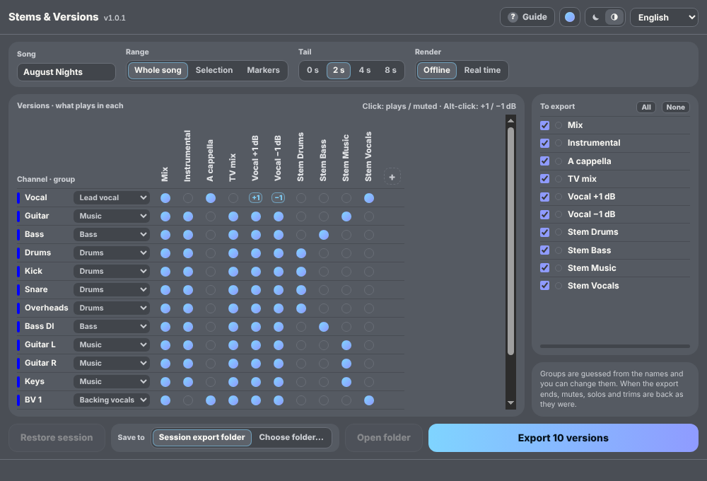

# Stems & Versions for LUNA

Stems & Versions exports every version of a song in one go. A table shows the session's
channels against the versions you deliver, a dot for what plays in each, and one button renders
them all with LUNA's own export. Your mix is put back exactly as it was when it ends.

  
  

## Features

- **Ten versions ready:** Mix, Instrumental, A cappella, TV mix, Vocal +1 dB, Vocal −1 dB and
  stems of Drums, Bass, Music and Vocals.
- **Pick what to export:** tick the versions you want in the list (All / None); only those are
  rendered.
- **Your own versions:** the **+** column adds a version; click its cells to choose what plays,
  and double-click its name to rename it.
- **Click a cell** to make a channel play or be muted in that version; **Alt-click** to raise or
  lower it by 1 dB instead. Click a version's name to leave it out of the export.
- **Groups guessed from names:** kick, snare, OH, bass, 808, vox, BV, coros, FX… in several
  languages, and you can change any channel's group. Aux buses stay on, since a muted track
  sends nothing to them.
- **Range:** the whole song (with 0, 2, 4 or 8 seconds of tail), the timeline selection, or
  from one marker to another.
- **Where the files go:** the session's export folder (LUNA's own export, with the session's
  export settings), or any folder you choose (WAV, rendered from the main bus).
- **Offline or real time**, the progress of each version, Stop, and Open folder when it ends.
- **Your mix is safe:** a channel muted in your mix stays muted in every version; mutes, solos and
  trims are put back afterwards, and if an export is ever interrupted, **Restore session** puts
  them back.
- **Your colour:** yellow, orange, red, green, blue, pink or purple; dark and grey themes.
- **7 languages:** English, Español, Català, Français, Deutsch, Italiano and Português.

## How to use it

1. Type the song's name: the files are named "Song - Version".
2. Check the groups and the dots, and add any version you need with **+**.
3. Tick the versions you want, choose the range and where to save, and press **Export**.

The first time it opens, it asks for your language and then a short guide walks you through the
window in it; the **Guide** button brings it back whenever you need it.

Level changes are made with each channel's trim, so they also work on channels with volume
automation. Stems pass through the main bus, so its processing (a bus compressor, say) acts on
each stem on its own.

## Support

If something does not work as expected, Alt-click the version number at the top of the window:
it copies a short report to paste in a message to fedetrillo@gmail.com.

## Install

Requires LUNA 3.1.2 or later. Install it from LUNA's Add On marketplace, or download
`stemsversions.lunaaddon` from the latest release and double-click it. Then open a session and
choose **Add Ons > Windows > Stems & Versions**.

## En español

Stems & Versions exporta de una vez todas las versiones de una canción: mezcla, instrumental,
a cappella, TV mix, voz ±1 dB y stems, desde una tabla de qué suena en cada una. Con **+**
añades versiones propias marcando las casillas que quieras, eliges cuáles exportar y en qué
carpeta. Al terminar, tu mezcla vuelve a
estar exactamente como estaba. Modo oscuro y gris, siete colores, 7 idiomas.

## Licence

Copyright (c) 2026 Fede Trillo. All rights reserved. Free to install and use in LUNA; the code
may not be copied, modified or redistributed. See [LICENSE](LICENSE). The bundled LUNA Builder
SDK is Universal Audio's, under the Apache License 2.0: see
[THIRD_PARTY_NOTICES.md](THIRD_PARTY_NOTICES.md).

Contact: fedetrillo@gmail.com
